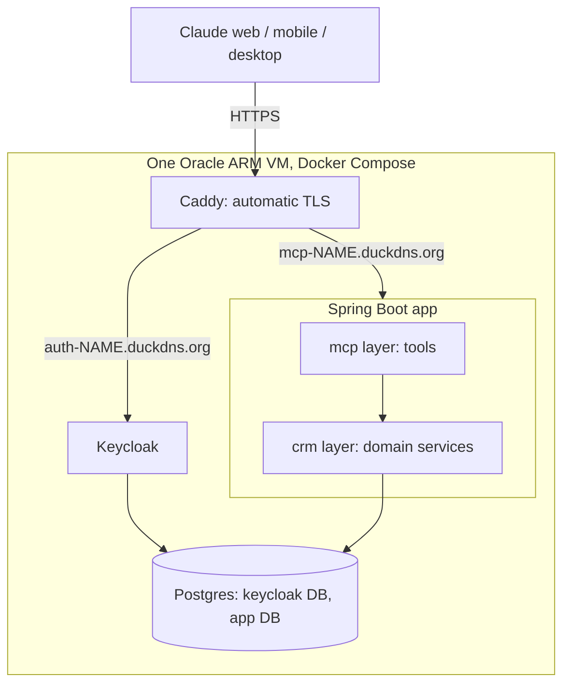

STATUS: DRAFT, revision 2 (2026-11-22), to be finished in Phase 0

# PROJECT_PLAN: MCP Demo Server (Spring AI + Keycloak on Oracle Free)

This is a starting point to critique, not a spec. Where it conflicts with `DECISIONS.md`, `DECISIONS.md` wins. Every fact marked **unverified** must be re-checked with a web search before it is relied on.

Revision 2 applies decisions D6 to D9: split-ready modular monolith, minimal CRM, one Postgres container, no token passthrough.

The Gradle build uses the Groovy DSL (`build.gradle`, `settings.gradle`) with no version catalog, as recorded in D13.

## 1. Goal

Build a self-hosted, OAuth-secured MCP server that Claude (web, mobile, desktop) connects to as a custom connector, plus a portfolio-quality repo (README, architecture diagram, scripted demo).

## 2. Working model

- **Claude (this project):** architect and spec writer. Produces high-level specs, reviews results, never writes code.
- **GitHub Copilot (IDE):** implements all code from the specs in `docs/specs/`.
- **Me:** carry specs to Copilot, bring back test results, logs and diffs.

## 3. Use case and tools

- **Decided (D7):** a CRM-style server with **minimum functionality**, with per-user data isolation.
- Guiding rule: the smallest tool set that demonstrates reads, writes, search and per-user isolation. Anything beyond that is scope creep and goes to the parking lot.
- **Still open, decided in Phase 0 topic 2:** the entities (working idea: contacts and interactions) and the tool list. Each tool is defined with name, purpose, inputs, outputs, and read or write.
- Alternative domains (notes, bookmarks, knowledge base) are not pursued.

## 4. Architecture

**Split-ready modular monolith (D6).** One Spring Boot app, two layers with a hard boundary:

- `mcp` layer: MCP tools, input validation, mapping to and from MCP responses. Knows nothing about SQL or repositories.
- `crm` layer: domain services and persistence. Knows nothing about MCP. Every method takes the caller's `sub` and scopes by it.
- The `mcp` layer may call only `crm` service interfaces. The boundary is enforced automatically so it does not erode. The mechanism (separate Maven modules or an architecture test) is open, decided in the stack topic.

Why this shape: the `crm` layer can later move behind its own API without rewriting the tools, and the demo reaches the riskiest part (claude.ai OAuth) sooner, with one JVM and one audience.

- **Two public hostnames** (auth and MCP) instead of path-based routing. Simpler. DuckDNS allows several subdomains.
- **One Postgres container** with two databases and two roles (D8). The Keycloak role cannot read the app database and the reverse.
- **Only Caddy publishes ports** (80 and 443). Keycloak, Postgres and the app are reachable only on the internal Docker network, except through Caddy's two hostnames.
- **No token passthrough (D9).** The app validates tokens issued for its own audience and forwards them nowhere.
- **Memory:** Keycloak, Spring Boot, Postgres and Caddy should fit in about 3 to 4 GB with JVM limits set. **Unverified.**
- **ARM:** all images (Keycloak, Temurin JRE, Postgres, Caddy) must have arm64 builds. **Unverified, check per image.**

## 5. Proposed components

| Piece | Proposal | Notes |
|---|---|---|
| MCP server | Spring AI MCP server starter, WebMVC variant, streamable HTTP protocol | Exact starter name and property keys to be verified for the pinned version |
| Server auth | Spring Security resource server plus the `mcp-server-security` community module | Requires WebMVC and JWT access tokens. No SSE transport, no opaque tokens. Community project, expect rough edges |
| Layer boundary | `mcp` layer calls `crm` service interfaces only | Enforced by an automated check. Mechanism open |
| Identity | Keycloak, one realm, one user (me), realm export committed to the repo | Client registration mechanism for Claude must be re-verified, see risks |
| Data | Postgres plus Flyway migrations | Every row owned by and scoped to the JWT `sub` |
| TLS and DNS | Caddy with automatic certificates, DuckDNS | |
| Backups | Nightly `pg_dump` to object storage | Small free allowance is enough for text data |

### Version compatibility (unverified)

- `mcp-server-security` 0.1.x reportedly works only with Spring AI 2.0.x. Spring AI 1.1.x reportedly needs 0.0.6.
- Proposal: use Spring AI 2.1.0 with Spring Boot 4.2.0 as pinned in `DECISIONS.md` (D7), managing Spring AI artifacts with its BOM.

## 6. How Claude connects (partly verified, re-check in Phase 4)

1. I add `https://mcp-NAME.duckdns.org/mcp` as a custom connector.
2. Claude reads the server's protected resource metadata, then Keycloak's authorization server metadata. (Verified for spec revision 2025-06-18: servers must publish protected resource metadata, clients must read authorization server metadata.)
3. Claude registers itself as a client. **Unverified, high priority:** the draft assumed Dynamic Client Registration. A third-party source reports a 2026-07-28 spec revision deprecated it. Find out which mechanism claude.ai uses today and what Keycloak supports. The redirect URI is reportedly `https://claude.ai/api/mcp/auth_callback` (unverified).
4. I log in at Keycloak. Claude sends the access token with every MCP call. The token carries the MCP server's audience, which the server validates. (Verified: clients must send the `resource` parameter.)

## 7. Hosting options (all limits unverified)

| Option | Verdict |
|---|---|
| **Oracle Always Free ARM (A1)** | Primary choice. Reported allowance after a mid-2026 cut: 2 OCPU and 12 GB RAM (previously 4 and 24). Signup needs a credit card. Home region cannot be changed later. A1 capacity can be scarce, so creation may need retries |
| **Home server or Raspberry Pi plus Cloudflare Tunnel** | Fallback if Oracle signup or capacity fails. Free, HTTPS without opening ports |
| **AWS** | Poor fit. Free plan for new accounts is time-limited (reportedly 6 months or until credits run out). Only for a time-boxed demo |
| **Hosted Postgres (Neon, Supabase)** | Not needed. The local container is simpler |

The compose setup must stay portable to any VPS, because free-tier terms can change without notice.

## 8. Phases

| Phase | Goal | Output |
|---|---|---|
| 0 | Refine the plan: tool list, data model, stack, hosting, risks (use case and architecture already decided) | Phase 0 spec, `DECISIONS.md` updated |
| 1 | Local skeleton: Compose with Keycloak, Postgres, one Spring app with the `mcp` and `crm` layers and the automated boundary check, realm export, one trivial tool | Phase 1 spec, Copilot instructions file |
| 2 | Tools and data: all tools, migrations, `sub` scoping, isolation tests | Phase 2 spec |
| 3 | Deploy: Oracle VM, ports 80 and 443 open in cloud firewall and VM firewall, DuckDNS, Caddy | Phase 3 spec |
| 4 | Connect Claude: add connector, run the real OAuth flow, fix issues | Phase 4 spec |
| 5 | Harden: close open self-registration in Keycloak, backups, README, architecture diagram, scripted demo | Phase 5 spec |
| 6 (optional, later) | Physical split: move the `crm` layer behind its own internal API in a separate container | Phase 6 spec. Only if the demo is done and there is a reason |

Each phase spec is saved to `docs/specs/` and contains goal, non-goals, pinned versions, components, tool contracts, data model, configuration, security requirements, Given/When/Then acceptance criteria, a test plan, and an ordered Copilot task list.

## 9. Risks to check early

- **Client registration mechanism (high priority, new).** The draft assumed Dynamic Client Registration. One source reports it was deprecated in a 2026-07-28 spec revision. Verify the current spec revision, what claude.ai actually uses, and whether Keycloak supports it. This may change the Keycloak design.
- **claude.ai OAuth with self-hosted servers.** Several 2026 GitHub issues reportedly describe connectors failing after the redirect back to claude.ai, with no token request reaching the server. May be fixed or setup-dependent. Test early (Phase 1 or 3), not last. Fallbacks: MCP Inspector, Claude Code, and a pre-registered client ID in the connector's advanced settings.
- **Keycloak client registration tuning.** If anonymous registration is used, it is restricted by client registration policies (trusted hosts, allowed redirect URIs). An audience mapper may be needed so the token's `aud` matches the MCP server. Exact settings for the current Keycloak version are unverified. Budget time here. Likely the most fiddly part.
- **Oracle policy drift.** The free allowance reportedly changed once without announcement. Keep the setup portable.
- **Keycloak memory.** Cap it with JVM options.
- **Community library maturity.** `mcp-server-security` may have gaps. Have a fallback plan in Phase 0.
- **Boundary erosion.** Without an automated check, the `mcp` layer will start calling repositories and the later split becomes a rewrite. The check is part of Phase 1.

## 10. Security requirements (baseline)

- Every data access scoped by the JWT `sub`, passed explicitly into every `crm` service call.
- An integration test proving user B cannot read user A's data.
- JWT audience validation against the MCP server's own identifier.
- The `mcp` layer never accesses repositories or the database directly. An automated check enforces this.
- No token passthrough: client tokens are never forwarded to another service.
- No open self-registration in Keycloak at the end.
- Secrets only in `.env`, never committed.
- Postgres has separate roles for Keycloak and the app. Only Caddy is publicly exposed.

## 11. Definition of done (baseline, finalized in Phase 0)

Claude.ai connects via OAuth to my own HTTPS MCP endpoint, all tools work on real data, isolation tests pass, the layer boundary check passes, backups run, and the README contains an architecture diagram and a scripted demo.

## 12. Ideas parking lot

- **later:** Phase 6, physical split of MCP and CRM API. Would need the CRM API on the internal network only, a second audience, and a way for the MCP layer to obtain its own credential for the CRM API (token exchange per RFC 8693 is the usual route; Keycloak support unverified).
- **later:** other use cases (notes, bookmarks, knowledge base). Not pursued.
- **later:** a minimal web UI for the CRM. Only relevant if the split happens.
