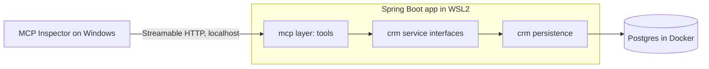

# Phase 1a Implementation Plan: Local MCP + CRM + Postgres

Status: DRAFT. Derived from `docs/DECISIONS.md` (D6, D7, D13, D14) and `docs/PROJECT_PLAN.md` sections 4, 5 and 10. If they conflict, `DECISIONS.md` wins. No code is written in this document.

## 1. Goal

Run one Spring Boot app on localhost (WSL2) with an `mcp` layer, a `crm` layer and a Postgres container, and test its tools with MCP Inspector from Windows. There is no auth, no Keycloak, no Caddy and no deployment.

## 2. Scope

In scope:

- Spring Boot app with MCP Streamable HTTP endpoint.
- `crm` layer with minimal contacts and interactions, persisted in Postgres with Flyway migrations.
- `mcp` layer with a small tool set that calls `crm` service interfaces only.
- Postgres in Docker Compose (Postgres only in this phase).
- Automated layer-boundary check.
- Documented run steps and Inspector test steps.

Out of scope (later phases): JWT or OAuth, Keycloak, Caddy, deployment, the full tool list, the physical split.

## 3. Decisions needed before coding

| # | Item | Why it blocks |
|---|---|---|
| O2 | Base Java package and group id | Settled: D15 |
| C1 | App directory | Settled: `mcp/` (AGENTS.md updated) |
| C2 | Spec index entry for 1a | Settled: index now points to this plan |
| C3 | Minimal tool list and data model | Settled: the five tools in section 5 are confirmed |
| C4 | The user identity without auth | Settled: fixed configurable dev `sub` property, replaced by the JWT `sub` in Phase 1b |
| C5 | Compose scope | Settled: D6 amended, Postgres in Compose is part of 1a |

## 4. Architecture

- `mcp` knows nothing about SQL or repositories. `crm` knows nothing about MCP.
- Every `crm` service method takes the caller's `sub` and scopes all queries by it, even though auth is absent.
- The boundary is enforced by an architecture test (a single module, so no multi-module split). Pick the tool (for example ArchUnit) after checking it supports the pinned Java 25 and Boot version.

## 5. Proposed minimal domain (to confirm in C3)

| Entity | Fields (proposal) |
|---|---|
| Contact | id, owner_sub, name, email (optional), notes, created_at |
| Interaction | id, owner_sub, contact_id, occurred_at, summary |

Proposed tools (name, purpose, read or write):

| Tool | Purpose | Type |
|---|---|---|
| `create_contact` | Create a contact | write |
| `list_contacts` | List the caller's contacts | read |
| `search_contacts` | Search by name or email text | read |
| `log_interaction` | Add an interaction to a contact | write |
| `list_interactions` | List interactions for a contact | read |

Each tool needs input validation and clear error results (unknown contact, blank name, contact owned by another sub returns not found).

## 6. Work steps (ordered, each ends with a check)

1. **Record decisions.** Settle O2, C1, C4 and C5 in `DECISIONS.md`. Check: file updated.
2. **Verify versions.** Look up the latest stable Spring AI 2.x release, a compatible Boot 4.x release, the Gradle wrapper (9.1.0 or newer), Java 25 support, the starter name `spring-ai-starter-mcp-server-webmvc`, the property keys and the default endpoint path (`/mcp`?). Use official sources only. Record them under "Verified versions" in `DECISIONS.md`. Check: no unverified keys remain in use.
3. **Environment check in WSL.** Java 25, Docker available in WSL, Node 22.7.5 or newer for Inspector. Check: version commands succeed.
4. **Project skeleton.** Gradle Groovy DSL (no version catalog, D13), wrapper, single module, empty Boot app, package layout `mcp` and `crm`. Check: wrapper build and context-load test pass.
5. **Postgres via Compose.** One Postgres service, named volume, port bound to localhost only, credentials from an uncommitted `.env` with a committed `.env.example` (placeholders only). Healthcheck. Check: container healthy, app connects.
6. **Schema.** Flyway migrations for contacts and interactions, `owner_sub` NOT NULL with indexes on it. Check: migration runs on a clean database and the app starts.
7. **`crm` layer.** Service interfaces, implementations and persistence, with `sub` as an explicit parameter. Check: service tests against real Postgres (Testcontainers or the Compose DB, decided at step 2), including user B cannot read user A's data.
8. **`mcp` layer.** Register the tools, validate inputs, map results and errors. Check: tool tests for success and for validation and error paths.
9. **Boundary test.** Fails if `mcp` depends on `crm` persistence types or on any data-access types. Check: a deliberate violation makes it fail, then remove it.
10. **MCP endpoint config.** Streamable protocol, HTTP on localhost. Check: an initialize request returns a valid response.
11. **Inspector run.** From Windows, start Inspector (UI 6274, proxy 6277), connect with Streamable HTTP to the WSL app via `localhost`. Keep the proxy session token on and do not expose the ports beyond localhost (past CVE-2025-49596, see `DECISIONS.md`). Check: the tools list shows all tools, and a create, list, search and log flow works.
12. **Run documentation.** README section with the exact start order (Compose up, app run, Inspector command, URL to enter) and troubleshooting for WSL localhost access. Check: a fresh clone works by following it.
13. **Full build.** `./gradlew build` passes, including the boundary test. Update `DECISIONS.md` status and spec index.

## 7. Acceptance criteria

- Given a clean clone, when I follow the README, then Postgres and the app run and Inspector connects from Windows through localhost.
- Given a connected Inspector, when I list tools, then every tool in section 5 is shown with its input schema.
- Given contacts created under dev sub A, when the service is called with sub B, then none are returned (automated test).
- Given invalid input (blank name, unknown contact id), when a tool is called, then a clear error result is returned and nothing is written.
- Given a `mcp` class that imports persistence types, when the build runs, then the boundary test fails.
- Given the repo, then no secrets or `.env` files are committed, and `graphify-out/` is ignored.

## 8. Risks

- Spring AI's versioned 2.1 reference URL currently redirects to an unversioned page with stale 2.0.x compatibility wording. The pinned Spring AI v2.1.0 repository README states Spring AI 2.x supports Boot 4.x; see the verified source and discrepancy note in `DECISIONS.md` and `docs/raw/step-02-verify-versions.md`.
- Inspector connecting from Windows to WSL: NAT mode normally forwards `localhost`. The fallback is to run Inspector inside WSL and open its UI from Windows.
- Starter defaults may leave the endpoint unauthenticated (documented). Bind to localhost only until Phase 1b.
- Fixed dev `sub` could leak into later phases. Make it a dev-only property and remove it when JWT is added.

## 9. Handoff to Phase 1b

Replace the dev `sub` with the JWT `sub`, add audience validation, add Keycloak and Caddy to Compose, keep the same `crm` interfaces unchanged.
